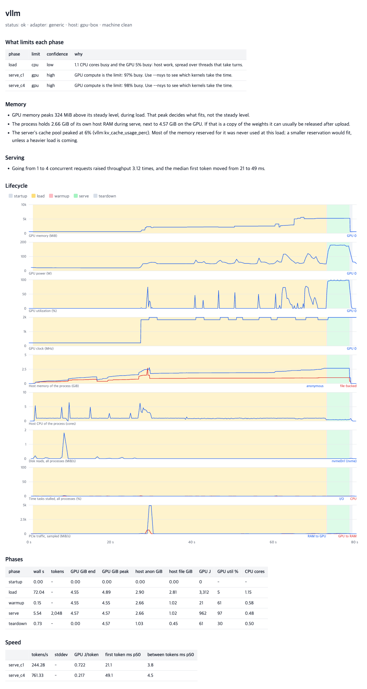

# llmprof

Tells you what limits an LLM engine, where its memory goes, and how its data moves between disk, RAM, CPU and GPU, over its whole life: load, warmup, prefill, decode, serving and shutdown.

It works with any engine and needs no code changes. Put it in front of the command you already run:

```sh
llmprof run -- llama-bench -m model.gguf -ngl 99
```

```
## What limits each phase

| phase  | limit        | confidence | why                                                                   |
|--------|--------------|------------|-----------------------------------------------------------------------|
| load   | disk (nvme)  | high       | Waiting on nvme reads: 820 MiB/s, I/O stall 36% of the time.          |
| decode | gpu          | high       | GPU compute is the limit: 96% busy. Use --nsys to see which kernels.  |

## Data movement findings

- Load read 0.68 GiB from nvme0n1 (nvme) at 820 MiB/s; 0% of the model was cached before the run.
```

Each run also writes `report.html` with every counter on one time axis, and `run.json` with all the numbers. This is the page for vLLM serving a small model on one GPU, from `llmprof serve --concurrency 1,4 -- vllm serve ...`:



## Install

Python 3.9 or newer on Linux. No dependencies. A C compiler is only needed for `--cpu-profile`.

```sh
pip install git+https://github.com/developer0hye/llmprof
# or, with no installation:
git clone https://github.com/developer0hye/llmprof && ./llmprof/bin/llmprof check
```

`llmprof check` lists what can be measured on the machine, and what the rest would take.

## Use it with your engine

Servers are started, loaded, stopped and measured in one command. llmprof finds the port, waits until the server is ready, sends streaming requests and reads its metrics.

```sh
llmprof serve -- llama-server -m model.gguf -ngl 99
llmprof serve -- vllm serve Qwen/Qwen3-0.6B
llmprof serve -- python -m sglang.launch_server --model-path Qwen/Qwen3-0.6B
llmprof serve -- text-generation-launcher --model-id Qwen/Qwen3-0.6B
llmprof serve --model qwen2.5:0.5b --pull -- ollama serve

# Containers work the same way. llmprof follows the engine inside, not the docker client.
llmprof serve -- docker run --gpus all -p 8000:8000 vllm/vllm-openai --model Qwen/Qwen3-0.6B
```

Choose the load with `--prompts file.jsonl` (rows with `prompt` or `messages`, such as [llm-speed-prompt-mix](https://huggingface.co/datasets/developer0hye/llm-speed-prompt-mix)), `--concurrency 1,4,8` and `--max-tokens 64`. A short nonce in front of each prompt keeps a server's prefix cache from answering, so prefill is really measured; `--reuse-prompts` turns that off. Any other OpenAI-compatible server works with `--preset openai --url http://host:port`.

Tested end to end with these engines, on one RTX 3070 with a small model unless noted:

| Engine | Version | How it ran | What it adds beyond the common report |
|---|---|---|---|
| llama.cpp `llama-bench`, `llama-server` | master `0ec4027a2` | native; also 8 RTX A6000 with a 748B model | exact per-run speed, load sub-phases, the engine's memory table |
| vLLM server | 0.32.0 | container | cache pool usage, request queue |
| vLLM as a library | 0.32.0 | container, `examples/vllm_offline.py` | phases from markers |
| SGLang | 0.5.22 | container | cache pool usage, weight and cache memory |
| Text Generation Inference | 3.3.7 | container | queue size |
| Ollama | 0.40.9 | container | model download as its own phase |
| transformers | as in the vLLM 0.32.0 image | container, `examples/transformers_generate.py` | PyTorch allocated against reserved memory |

For an engine used as a library, wrap the script. Phases are optional, and `llmprof.mark` does nothing when no profiler is running:

```python
import llmprof

with llmprof.phase("load"):
    model = AutoModelForCausalLM.from_pretrained(name, device_map="auto")

timer = llmprof.TokenTimer()
with llmprof.phase("decode", tokens=128):
    model.generate(**inputs, max_new_tokens=128, streamer=timer)
print(timer.summary())
```

```sh
llmprof run -- python script.py
```

See [examples/](examples/) for transformers and vLLM. Something already running can be profiled too: `llmprof attach --docker NAME --url http://127.0.0.1:8000`.

Any program can announce phases in other ways, with no dependency on llmprof:

```sh
llmprof run --mark 'Model loaded=decode' -- my-engine        # a line in its output starts a phase
echo decode >> "$LLMPROF_MARKERS"                            # or append to this file from any language
```

## What it answers

**What limits this phase?** Each phase gets one verdict with the numbers behind it: `gpu`, `gpu (throttled)`, `gpu imbalance`, `gpu + host wait`, `cpu (one thread)`, `cpu (many threads)`, `cpu contention`, `disk (nvme|ssd|hdd)`, `ram`. It rests on the kernel's pressure stall counters, GPU utilization history, per-thread CPU time and disk activity. A phase too short for these counters is reported as too short.

**Is memory being overused?** llmprof reports GPU memory per device and per process, host memory split into anonymous and file-backed, swap, and the engine's own breakdown where it gives one. It flags:

- a GPU or the host running out of headroom
- a transient peak that decides what fits
- host memory that keeps growing, as a leak would
- weights held in RAM next to their GPU copy
- PyTorch reserving far more than its tensors use, and cache pools that are mostly unused
- GPUs filled unevenly

**Where does data travel?** Per phase: bytes read and written per disk, with NVMe, SSD and HDD told apart; swap in and out; page cache changes and refaults; major page faults; RAM to GPU and back over PCIe; GPU to GPU over NVLink. Reads from disk during inference are flagged, because they mean the weights are not staying in RAM. `--cold-start` drops the model from the page cache first, without root, so a load can be measured as a user's first run would see it.

**Where does the GPU's time go?** Add `--nsys` for kernels, collectives, copies and idle gaps per phase and per token, the host's time in CUDA calls, and exact bytes copied. Add `--cpu-profile` for the hot functions of the host threads. It samples from inside the process, so it works where `perf` is not allowed. Both slow the engine down, so those runs are marked and never counted as speed results.

**What did a change cost?** `llmprof matrix` runs two builds in alternating order across many cases, in fresh processes, re-checking the machine before each arm. It judges speed, memory, load time and energy together, so a speed win that costs memory shows up as a regression. A difference counts only if the arms do not overlap and it exceeds the noise floor. Measure that floor with the same binary on both sides.

```sh
llmprof matrix --cases cases.json --a old=build-old/bin --b new=build-new/bin --out res
```

## Trusting the numbers

- **The tool's own cost is measured.** Sampling happens in another process, pinned away from the engine's CPUs when it can be. Speed with llmprof against without it, alternating fresh processes, 4 arms each of 10 repetitions, on 8 RTX A6000 (the same binary against itself varies by about 1% at 8 GPUs):

  | Case | Prefill | Decode |
  |---|---:|---:|
  | Qwen3-30B-A3B Q8_0, 1 GPU | 1.00 | 1.00 |
  | Qwen3-30B-A3B Q8_0, 8 GPUs, tensor split | 0.998 | 1.000 |
  | DeepSeek-V4.1-Flash, 8 GPUs, tensor split | 1.001 | 1.001 |

- **Every run checks itself.** Phase times are compared with the engine's own timers where it has them; it was 1.000 to 1.001 in the runs above. Power from the energy counter is compared with the power gauge, because the counter was caught under-reporting by half when read too often; llmprof reads it about twice a second, and a large disagreement is called out in the report.
- **Known answers.** A RAM-limited run (a 450 MiB cgroup around a 639 MiB memory-mapped model) took decode from 48.7 to 2.3 tokens/s; the report named `ram` as the limit, with 18.8 GiB read back from disk and 158,150 major faults. GPU memory from NVML matched llama.cpp's own table to within driver overhead. GPU kernel times matched a separately written analysis of the same trace.
- **Every run stores its context.** That means foreign CPU and GPU load, the page cache state of the model, the storage it lives on, binary hashes, the git commit and relevant environment variables. Runs on a busy machine are flagged, and `--precheck wait` waits for it to go quiet.
- **Hung runs stop.** A collective that spins forever looks busy to every utilization counter, so progress means output or resource changes. A stalled run is killed with a report of what its threads were doing.
- **Credentials stay out.** Tokens and keys in the command line and environment are never written to the report.

The test suite runs real processes with known behaviour and checks that the report says what happened: `cd tests && python3 -m unittest`.

## Limits

- Linux only. GPU telemetry is NVIDIA only for now (`gpu.py` has a small interface for other vendors); without it you still get host metrics and phases.
- GPU hardware counters such as cache hit rates need admin rights (`RmProfilingAdminOnly=0`). llmprof does not read them yet.
- Memory bandwidth on the host is not visible without privileges.
- PCIe traffic is a sample, not a count. Use `--nsys` for exact copy bytes.
- System-wide counters (disks, swap, pressure) include other processes. On a shared machine, trust the per-process columns.
- NVML's GPU utilization needs about a second to mean anything, which is why short phases are not judged.

## License

Apache-2.0
