# Figures for papers and reports

`llmperfscope figure` turns a run into figures you can put straight into a paper, with their data and a suggested caption.

```sh
pip install "llmperfscope[figures]"
llmperfscope figure RUN_DIR --out figures
```

For each figure the run has data for, you get:

| File | Use |
|---|---|
| `lifecycle.pdf` | vector, for LaTeX. Fonts embedded as TrueType, which venues require (they reject Type 3) |
| `lifecycle.svg` | vector with real text, to edit in Inkscape or Illustrator |
| `lifecycle.png` | 300 dpi, for Word or slides |
| `lifecycle.csv` | the numbers drawn, to replot or to submit as source data |
| `captions.md` | a suggested caption per figure, and a "how it was measured" paragraph for the methods section |

The same run gives byte-identical PDF and SVG files, so figures can be regenerated and diffed. Nothing in them records when or where they were made.

Every image below comes from a run in [examples/sample-runs](../examples/sample-runs). [gallery/make.sh](gallery/make.sh) has the exact commands.

## What each figure shows

### `lifecycle`: everything over time

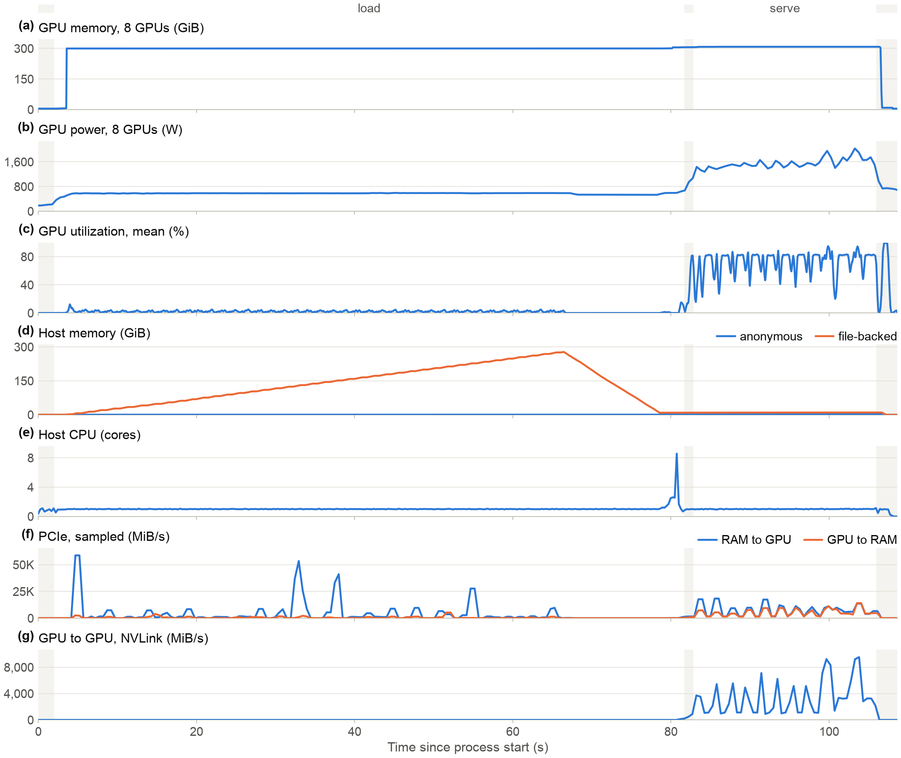

The whole life of a run on one time axis, with phases as bands. Panels with nothing to show are left out. This one is DeepSeek-V4.1-Flash on 8 GPUs serving requests. Choose panels with `--panels gpu_memory,util,host_memory`, zoom with `--xlim 80,100`, and draw one line per GPU with `--per-gpu`.

Panels: `gpu_memory`, `power`, `util`, `clock`, `host_memory`, `cpu`, `disk`, `stall`, `pcie`, `nvlink`.

Here is a model running with less RAM than it needs. Decode falls from 73.9 to 2.5 tokens/s, and the disk reads at about 1.5 GiB/s the whole time:

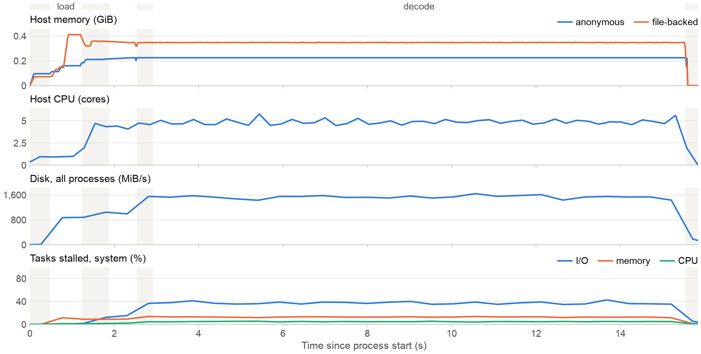

### `phases`: where the time and the energy go

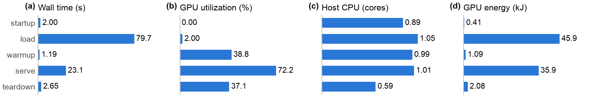

### `memory`: what holds memory, and when

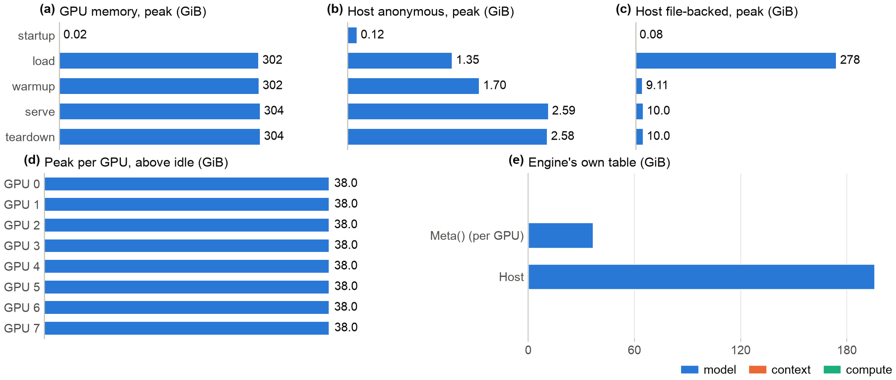

### `movement`: data between disk, RAM and GPU

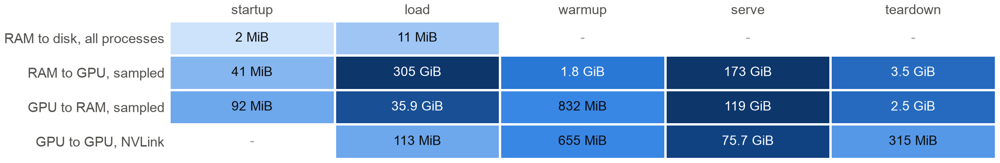

Color is on a log scale, because one phase can move hundreds of GiB and another a few MiB. Rows that are empty for the whole run are left out, so a row for reads from disk only appears when there were some.

### `serving`: throughput and latency under load

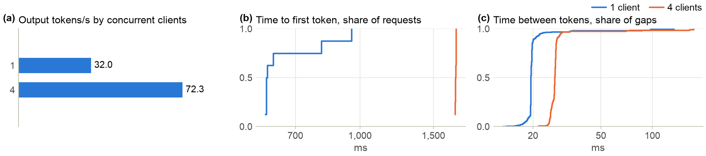

Needs a run from `llmperfscope serve`. The distributions are from each request as a streaming client saw it.

### `gpu-time`: kernels, collectives, copies and idle

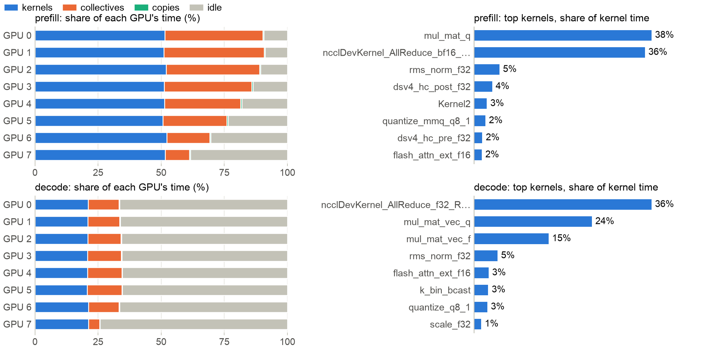

Needs a run with `--nsys`. Tracing slows the host, so idle reads higher than in an untraced run. Use it for where time goes, not for speed. The suggested caption says so.

### `hotspots`: host CPU by function

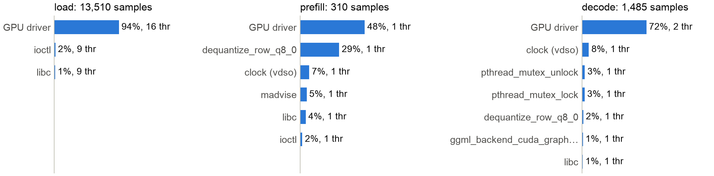

Needs a run with `--cpu-profile`. `thr` is the number of threads that ran the function. A function at 30% on one thread limits a phase in a way that the same share on sixteen threads does not. Libraries without symbols are named for what they are, and the CSV keeps the full names.

## Comparing runs

```sh
llmperfscope figure --compare "enough RAM=runs/a" "450 MiB of RAM=runs/b" --out figures
```

Kinds: `speed`, `memory`, `energy`, `phases`, `serving`.

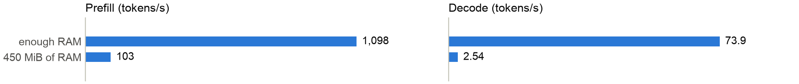

Error bars show the standard deviation over repetitions, when there were several.

The next three figures show what comparing engines looks like. **They do not rank the engines.** Each ran on one RTX 3070 with default settings and nothing was tuned, and they are not all the same model or format: llama.cpp ran a Qwen3-0.6B Q8_0 GGUF, vLLM, SGLang and TGI the original Qwen3-0.6B weights, and Ollama qwen2.5:0.5b. All but llama.cpp ran in containers.

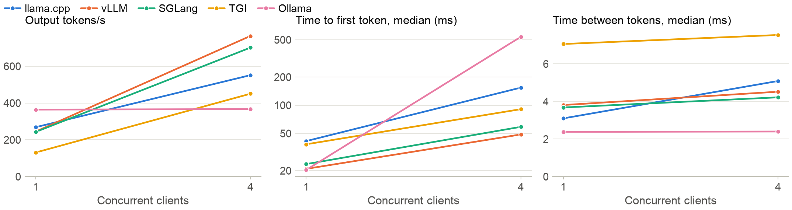

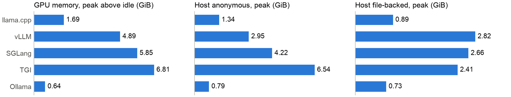

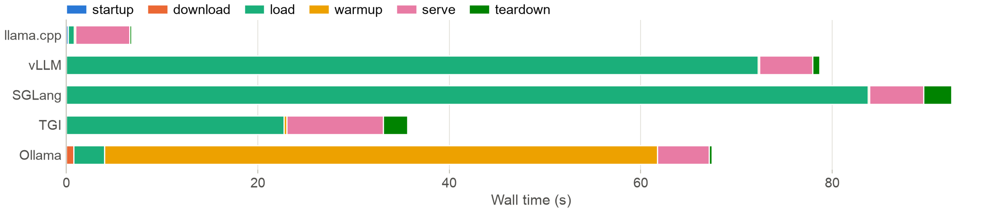

## Before and after, over many cases

```sh
llmperfscope figure --matrix res/matrix.json --out figures
```

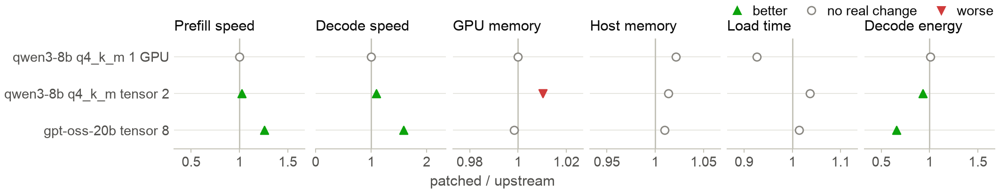

Marker shape carries the verdict, so it survives grayscale. A result counts as better or worse only when the arms do not overlap and the difference exceeds the noise floor. See [comparing.md](comparing.md). This example is a real result of a speed-up that costs a little GPU memory in one case, and the figure shows it.

## Matching your venue

Set the width your layout uses. The text keeps its point size, and in a narrow figure the panels stack instead of running into each other:

| Layout | `--width` |
|---|---|
| IEEE, one column / two columns | `single` (3.5 in) / `double` (7.16 in) |
| ACM `sigconf`, USENIX, one column / two columns | `3.33` / `7` |
| ICML, one column / two columns | `3.25` / `6.75` |
| NeurIPS, ICLR | `5.5` |

| Option | Effect |
|---|---|
| `--font serif` | Times New Roman where available, for a serif paper |
| `--font "Your Font"` | any installed font |
| `--font-size 8` | base size in points, 7.5 by default |
| `--height 3` | height in inches, fitted to the content by default |
| `--letters` | panel labels (a), (b), ... |
| `--print-safe` | line styles and hatching, for grayscale print |
| `--title "..."` | a title. Off by default, because papers use the caption |
| `--format pdf` | only some formats |
| `--dpi 600` | PNG resolution |

In LaTeX, include the figure at the width you asked for, so the text stays the size you chose:

```latex
\begin{figure}[t]
  \centering
  \includegraphics[width=\columnwidth]{figures/phases.pdf}
  \caption{...}
  \label{fig:phases}
\end{figure}
```

For a two-column figure use `figure*` and `\textwidth`.

## Colors

Series colors follow one fixed order, checked for color vision deficiency against a white background. A series keeps its color whichever others are shown. Lines that cross are told apart by more than hue when you pass `--print-safe`, and the verdicts in `matrix` use shape as well as color.

## Checklist before you submit

- [ ] Speed numbers come from runs without `--nsys` or `--cpu-profile`. Those runs are marked `perturbed`, and the captions of traced figures warn about it.
- [ ] The report said the machine was clean, or you can explain what else was running.
- [ ] Speed from `llama-bench` is labeled as random tokens, or confirmed with real prompts (`llmperfscope serve --prompts mix`). The "how it was measured" paragraph says which.
- [ ] A load time says whether it was warm or cold (`--cold-start`). The report states how much of the model was in the page cache.
- [ ] A comparison runs on the same hardware, with its noise floor stated. See [comparing.md](comparing.md).
- [ ] The methods section has the engine commit, driver and hardware. `captions.md` has them in its "how it was measured" paragraph.
- [ ] Any comparison between engines says what was and was not tuned.
- [ ] To publish the raw runs, copy them with `llmperfscope anonymize RUN --out DIR` first.

## Sharing the data behind a figure

```sh
llmperfscope anonymize runs/mine --out shareable/mine
```

The copy keeps every number and removes host and user names, absolute paths, GPU serial numbers, other people's process names, logs, prompts and request ids. `llmperfscope figure`, `show` and `diff` all work on the copy. Check the result before publishing it: labels you chose, and any names in your command line that are not paths, stay as they are.
