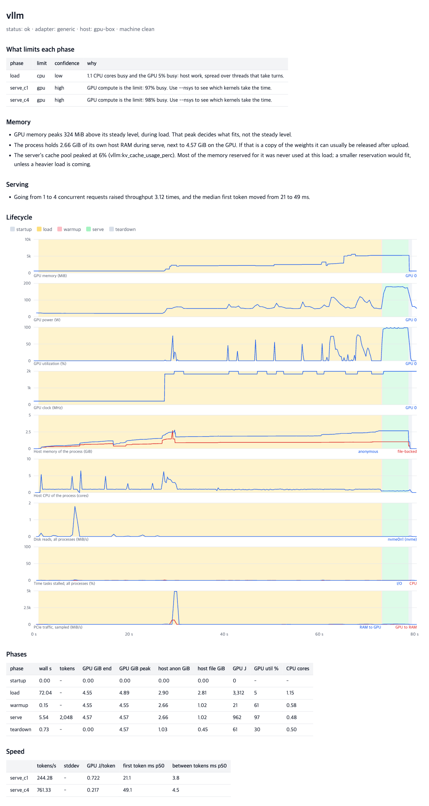

# Reading a report

`llmperfscope show RUN` prints this report again, and `report.html` has the same findings above charts on one time axis. Examples here come from [examples/sample-runs](../examples/sample-runs).



## What limits each phase

Each phase gets one verdict, one confidence and the numbers behind it. The rules run in the order below and the first match wins. Memory and disk come first because a phase waiting on them can make every other counter look idle.

| Verdict | Fires when | Try next |
|---|---|---|
| `ram` | swap above 1 MiB/s, or tasks fully stalled on memory above 5% of the time, or file pages re-read above 50 MiB/s with memory stalls above 2%. On macOS: critical memory pressure above 5% of the time, or memory pressure with swap or compressor traffic while neither the GPU nor the CPU is busy | Give it more RAM, use a smaller model, or stop using mmap for CPU-side tensors |
| `disk (nvme)`, `(ssd)`, `(hdd)` | reading above 5 MiB/s, with I/O stalls above 25% or the disk above 60% busy | Faster storage, or keep the model in the page cache |
| `too short to judge` | under 1 s, too short for the GPU's utilization counter | Use a longer run |
| `gpu (throttled)` | above 50% busy and clocks held down by heat or a hardware limit, or by the power cap while really near the power limit | Cooling, power limit |
| `gpu imbalance` | the busiest GPU above 80% and more than 25 points above the idlest | Split work more evenly. The busiest GPU sets the pace |
| `gpu` | at least 85% busy | `--nsys` to see which kernels. On a Mac, Instruments' Metal System Trace |
| `cpu contention` | runnable tasks waited for a CPU above 30% of the time | Find what else is running, pin the engine |
| `cpu (many threads)` | GPU under 30% and at least 2 cores busy | `--cpu-profile`. Part of the model may be on the CPU |
| `cpu (one thread)` | GPU under 30% and one thread above 70% | `--cpu-profile`. Everything waits for this thread |
| `gpu + host wait` | GPU at least 30% busy and nothing else saturated | `--nsys` for the gaps, `--cpu-profile` for the host |
| `cpu` | at least 0.7 cores busy over threads that take turns | `--cpu-profile` |
| `client or idle` | serving with nothing saturated | The server has spare capacity at this load |
| `none visible` | nothing above fired | The wait is somewhere these counters do not see |

A server gets one verdict per concurrency level, because it can hit a different limit at each.

Here is a run with too little RAM, from `cpu-ram-limited`. A 639 MiB memory-mapped model ran on the CPU inside a 450 MiB memory limit:

```
| decode | ram | high | Host RAM is short: 333 MiB/s of file pages dropped and read again, tasks stalled on memory 13% of the time. |
```

And the 8 GPU server, from `deepseek-v4.1-flash-8gpu-serve`, where neither the GPU nor the host is saturated while serving:

```
| serve_c1 | gpu + host wait | medium | GPU 71% busy with nothing else saturated, so the rest of the time is host work or synchronization. |
```

## Memory findings

Each finding says how much, where and when. `warning` means it probably costs you something now, and `info` means it may be worth a look.

| Finding | Means |
|---|---|
| `gpu_memory_nearly_full` | a GPU reached 95% of its memory: a longer prompt or more parallel requests can run out |
| `gpu_memory_uneven` | some GPUs fill more than others, and the fullest decides what fits |
| `gpu_transient_peak` | memory peaks above the steady level. The peak decides what fits |
| `gpu_memory_growing`, `host_memory_growing` | growth during inference. One run cannot tell a leak from a cache filling up, so run longer and see whether it levels off |
| `host_ram_held_while_on_gpu` | the process keeps a lot of its own RAM next to the GPU copy, maybe a copy of the weights |
| `weights_mapped_in_page_cache` | mapped files in RAM. They can be reclaimed, so this is no leak, but it is why free RAM looks low |
| `weights_on_host` | part of the model stays in host buffers, so CPU work depends on the page cache |
| `compute_buffers_large` | compute buffers take a large share. They scale with batch size |
| `gpu_memory_unaccounted` | memory in use that the engine cannot account for: other processes or the driver |
| `torch_reserved_above_allocated` | PyTorch's allocator holds far more than its tensors use |
| `kv_cache_mostly_unused`, `kv_cache_full` | a server's cache pool stayed under 25%, or reached 95% |
| `process_swapped`, `host_ram_nearly_full` | part of the process was in swap, or available RAM fell under 5% |
| `gpu_memory_after_exit` | a GPU still holds extra memory a second after the process ended |

**Anonymous against file-backed.** Anonymous memory is what the process allocated. File-backed memory is a mapped file, usually the weights. The kernel can drop it and read it back later, so it is cheap until RAM runs short. In the 8 GPU sample the file-backed line climbs to 278 GiB during load and falls to 10 GiB, which is the weights passing through on their way to the GPUs.

## Data movement

The table has one row per phase, in MiB. A column this machine has nothing to report for is left out. The sources are named for Linux; [Apple Silicon](engines.md#apple-silicon) lists the macOS ones.

| Column | Where it comes from | Scope |
|---|---|---|
| target disk read | `/proc/<pid>/io` | this process tree |
| all disk read, all disk write | `/proc/diskstats`, physical disks only | the whole machine |
| swap in, swap out | `/proc/vmstat` | the whole machine |
| compressed, decompressed | macOS only: memory through the compressor | the whole machine |
| page cache +/- | `/proc/meminfo` | the whole machine |
| RAM to GPU, GPU to RAM | NVML, sampled | used GPUs. An estimate |
| GPU to GPU | NVLink counters | used GPUs |
| major faults | `/proc/<pid>/stat` | this process tree |

The findings that matter most:

- `disk_reads_during_inference`: the weights or cache are not staying in RAM. In `cpu-ram-limited` this is 18.79 GiB read and 49,217 major faults for 32 tokens of a 0.6 GiB model.
- `swapping_during_inference`, `disk_writes_during_inference`.
- `memory_compressor_busy`, on macOS: over 50 MiB/s went through the memory compressor. macOS does this to other programs' idle memory too, so it costs the engine CPU time and steadiness rather than RAM. The numbers are in the `compressed` and `decompressed` columns.
- `heavy_host_gpu_traffic`: over 8 MiB crosses PCIe per token during decode. That could be partial offload, a collective going through host memory, or a GPU polling host memory. `--nsys` gives the exact bytes of real copies, and what remains is the other two.
- `cpu_gpu_split`: the GPU is under 50% busy while at least 3 cores work, so part of the model is probably on the CPU.
- `gpu_to_gpu_traffic`: how much crosses NVLink per token.
- `model_on_slow_storage`, `load_read_from_disk`, `load_from_page_cache`: how a load time should be read. A warm load says little about a user's first run. Use `--cold-start` for that.
- `slow_first_use`: warmup over 5 s, from on-demand loading or kernels compiled on first use.
- `work_in_another_process`: at least 2 s of startup, load or warmup with the process nearly idle while the machine is busy. On a Mac this is usually the Metal shader compiler on first use.

Storage is told apart as NVMe, SSD, HDD, network or unknown. A RAID array of rotating disks reports as HDD and can still be fast, so the measured speed decides whether this counts as a warning.

## Model structure findings

These need the model's header. See [llm-structure.md](llm-structure.md).

- `decode_against_memory_bound`: the least time a token needs to read its weights, against decode.
- `moe_share_of_a_token`: how much of the model and how much of a token the experts are.
- `kv_cache_cost_grows_with_context`: what each 1000 tokens of context add between tokens.
- `speed_depends_on_content`: the time between tokens differs by language or domain.
- `speculative_decoding`: tokens drafted and accepted.
- `graphs_reserved_per_request`: how often llama-server reserved graph memory again.
- `prompt_cache_used`: how much of the prompts came from the server's cache.
- `first_token_by_turn`: first token as a conversation grows, with `--turns`.

## Serving findings

- `parallel_scaling` reports how much throughput rose from one concurrency level to the next, and what happened to the first token.
- `no_parallel_scaling` is a warning that throughput barely rose, so requests are queueing. Check the server's parallelism setting.
- `failed_requests` quotes the first error.
- `first_token_fixed_part` says that for the median prompt most of the first token does not depend on the prompt's length. That is work per request, such as building graphs or saving a cache checkpoint, and benchmarks with long prompts do not show it.

The speed section has time to first token (TTFT) and time between tokens as a streaming client saw them, with mean and percentiles, and GPU energy per output token. With few requests the p99 is close to the maximum, so run more prompts before you quote it.

The first token also comes as a line, `first token = 150 ms + 0.70 ms per prompt token`, and as a table by prompt length. The line is a Theil-Sen fit, a median of slopes, so a few long prompts or slow requests do not decide it. It leaves out tokens that came from the cache and needs at least 8 requests with lengths at least a factor of 2 apart. Read it at the lowest concurrency: with more clients it also holds the time spent in the queue.

## Findings from `--nsys` and `--cpu-profile`

These appear only in runs with those options. See [deep-dives.md](deep-dives.md).

- `gpu_time_split`: how each GPU's time divides between kernels, collectives, copies and idle, with the top kernels.
- `host_api_time`: which CUDA calls take the host's time.
- `host_waits_for_gpu`: how many host samples wait for the GPU, and in which functions.
- `exact_copies`: the bytes really copied, per direction and per token.
- `host_cpu_split`: how much host CPU is inside the GPU driver, and the hottest functions outside it, with how much of the phase each can account for at most.

## Lifecycle table

One row per phase group, showing wall time, tokens, memory at the end and at the peak, energy, power, clocks, utilization and busy CPU cores. GPU memory is above the idle level before the run, over the GPUs this run used. `Used` means the target held memory on it; other GPUs are ignored.

Phases: `startup` is from process start to the first sign of loading, and `load`, `setup`, `warmup`, `prefill`, `decode`, `serve` and `teardown` are what they say. A run may also have `download`, `run` (no finer phases known) or `observe` (attached, watching). The report leaves out `baseline`, sampled before the process starts, and `tail`, sampled after it ends. These two provide the idle level and show what stays behind.

## Notes about the input

A report from `llama-bench` notes that it feeds random tokens. Caches, expert routing and table lookups behave differently with real text, so treat its speeds as a first look and confirm a gain with `--prompts mix`.

## The last lines

```
Self-check: power from the energy counter / power gauge = 0.989 (should be near 1).
Sampler: 46.7 Hz of 50.0, largest gap 440.8 ms, 13.76 CPU s, on CPU 255.
```

These say how far to trust the rest:

- **Self-check.** Far from 1, the energy numbers are suspect. Phase times are also compared with the engine's own timers where it has them.
- **Sampler.** A rate far below the target gets a note in the report. Cumulative counters stay right when samples are lost, but a short spike can be missed.
- **Machine state.** The header says whether the machine was clean when the run started. Otherwise it lists what was running, such as foreign CPU or GPU load, a build, or low memory. `--precheck wait` waits for a quiet machine, and `--precheck require` refuses to run on a busy one.

`status` is `ok`, or says what went wrong: `timeout`, `stalled`, `interrupted`, `workload_failed` (the requests could not run) or `failed` (the program exited with an error). A stalled run was killed for showing no output or resource change for `--stall` seconds, because a collective that spins forever looks busy to every utilization counter. The report then shows what its threads were doing.
